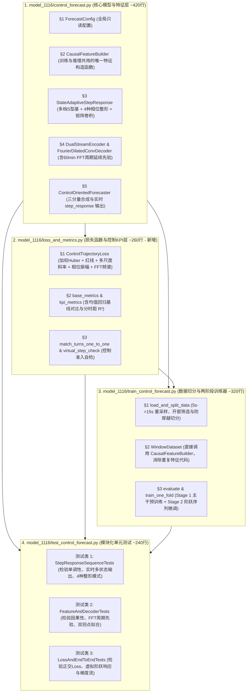

# 分解炉尾煤温度预测项目（`fjl_temp_pre`）技术原理剖析与模块化重构计划书

---

## 第一部分：核心技术问题诊断（v1 ~ v5 精度瓶颈与 v5 退化机理）

### 1.1 历代实验量化指标全景对比（3,302 个相同开发验证窗口）

预测任务定义为：给定历史 60 分钟（$L_{\text{in}}=240$ 步，$\Delta t=15\text{s}$）的分解炉出口温度 $T_{t-239:t}$ 与尾煤实际流量 $u_{t-239:t}$，以及未来 15 分钟（$H=60$ 步）的候选尾煤轨迹 $u_{t+1:t+60}$，预测未来 15 分钟的相对温度变化轨迹 $\Delta \hat{T}_{t+1:t+60} = \hat{T}_{t+1:t+60} - T_t$。

| 模型版本 | 核心技术特征 | Oracle 加权 RMSE | Hold 诊断 RMSE | 15min 端点 RMSE | 剔除前3步振幅比 (`body_p2p`) | 拐点时间 MAE / 漏检率 | 物理通道状态 ($c_{\text{cl}}$ / $\gamma$ / $\bar{K}_t$) |
|---|---|---:|---:|---:|---:|---:|---|
| **一阶指数均值回归基线** | $\Delta \hat{T}_{t+h} = (900.57 - T_t)(1 - e^{-h/15})$ | 24.13℃ | 24.13℃ | 26.95℃ | 0.412 | — | 无物理通道（纯静态基线） |
| `v1_direct` | 单流 PatchTST 直接回归 $\Delta T$ | 24.21℃ | 24.21℃ | 26.82℃ | 0.598 | — | $c_{\text{cl}}=0$ |
| `v3` | 双流 PatchTST + 一阶 FOPDT + 网格标定 | **23.76℃** | **23.39℃** | 26.66℃ | 0.779 | 3.28步 / 54.1% | $c_{\text{cl}}=0.10, \bar{K}_t=12.28$ |
| `v4_in_flight` | 新增 60 步历史在途余热一阶状态递推 | 23.96℃ | 23.42℃ | **26.22℃** | **0.796** | **3.21步 / 53.1%** | $c_{\text{cl}}=0.10, \gamma=0.18, \bar{K}_t=11.40$ |
| **`v5_updated`** | **强锁高耦合 ($c_{\text{cl}}\ge 0.65, \gamma\ge 0.60$) + 近端煤量屏蔽 + 6基函数解码** | **27.84℃** ❌ | 26.12℃ | 30.74℃ ❌ | 0.615 ❌ | 4.13步 / 72.7% ❌ | $c_{\text{cl}}=0.875, \gamma=0.908, \bar{K}_t=\mathbf{7.50}$ (塌缩) |

---

### 1.2 深度技术诊断：为什么 `v5` 发生严重退化？为什么远期（5~15min）预测精度不足？

#### （1）物理机理失配：一阶指数 FOPDT 的“零时刻最大导数特性”引发闭环反相相消
在 [sa208_control_forecast_v5_updated/control_forecast.py](file:///Users/wuweilong/Desktop/研发/fjl_temp_pre/model_1116/sa208_control_forecast_v5_updated/control_forecast.py#L118-L133) 中，尾煤对温度的阶跃响应被建模为一阶惯性加纯滞后（FOPDT）：
$$G_{\text{FOPDT}}(s) = \frac{K e^{-\theta s}}{\tau s + 1} \implies \text{阶跃响应 } s(t) = K\left(1 - e^{-(t-\theta)/\tau}\right), \quad \text{脉冲响应 } h(t) = \frac{ds(t)}{dt} = \frac{K}{\tau} e^{-(t-\theta)/\tau}$$
- **数学缺陷：** 一阶指数函数的脉冲响应 $h(t)$ 在 $t = \theta^+$（即跨过纯滞后 `dead_steps=1` = 15s 的瞬间）**取得全局最大值 $\frac{K}{\tau}$**，随后单调衰减。这意味着任何煤量调整在最初的 $15\text{s} \sim 2\text{min}$ 内产生最剧烈的温度变化率。
- **物理与控制矛盾：**
  1. **高阶热工传递滞后：** 分解炉内“给煤机下料 $\to$ 气固悬浮分散 $\to$ 挥发分着火 $\to$ 焦炭燃尽 $\to$ 煅烧生料吸热平衡 $\to$ 出口热电偶感温”本质上是**多级串联分布参数热容系统**（全程响应时间约 $900\text{s}=15\text{min}$）。其真实的阶跃响应曲线 $s(t)$ 具有显著的**二阶/高阶 S 型下凹起步特征**（在 $t=\theta^+$ 处不仅 $s(t)=0$，且一阶导数 $s'(t)=0$），在最初的 $0\sim 2.5\text{min}$（响应完成度 $< 20\%$ 阶段）宏观温升极小，最大斜率出现在拐点 $t \approx 3\sim 6\text{min}$ 处。
  2. **闭环反馈负相关混杂（Closed-Loop Confounding）：** 历史数据中尾煤受 PID+DMC 闭环控制（$\text{Corr}(\Delta u_t, \Delta T_t) = -0.737$）。在预测窗口前半程（$0\sim 6\text{min}$），当外部替代燃料热值突增引起温度冲顶时，控制器同步大幅减煤；由于 `v5` 采用一阶指数模型且强行锁死 `closed_loop_coupling = 0.875`，前半程的减煤动作在 $1\sim 5\text{min}$ 内立即产生高达 $-15\sim -20^\circ\text{C}$ 的负向受迫响应，直接将神经网络预测的波峰削平（如样本 [#001](file:///Users/wuweilong/Desktop/研发/fjl_temp_pre/model_1116/sa208_control_forecast_v5_updated/100样本肉眼评估/sample_001.png)）。而在后半程（$7\sim 14\text{min}$），前半程减煤的真实冷却效应刚刚到达，真实温度快速回落，控制器随之重新加煤，一阶指数模型又在后半程立刻跟随加煤向上翘起（实测 `v5` 受迫响应在后半程 $6\to 14\text{min}$ 的变化量与真实温变呈 **$-0.519$ 的强反相**），导致 Stage 2 反向传播将增益 $K_t$ 100% 推向物理下界 `7.5`。

#### （2）远期预测（5~15min）退化为“静态条件均值回归”
对验证集各预测步 $h \in [1, 60]$ 的**未来绝对温度 $\hat{T}_{t+h} = T_t + \Delta \hat{T}_{t+h}$** 计算决定系数 $R^2(h) = 1 - \frac{\sum (\hat{T}_{t+h} - T_{t+h})^2}{\sum (T_{t+h} - \bar{T})^2}$ 发现：
- 在 $h \le 12$（前 3 分钟），各模型依靠近期差分斜率外推，$R^2$ 保持在 $0.99 \to 0.40$；
- 在 $h \ge 20$（**5 ~ 15 分钟远期**），`v1`~`v5` 所有模型的绝对温度 $R^2$ **全面跌至 $0.11$ 以下，10~15 分钟处甚至为负（$-0.11 \sim -0.52$）**。
- **技术根源：**
  1. `SmoothTrendBasisDecoder`（[control_forecast.py 第 539-546 行](file:///Users/wuweilong/Desktop/研发/fjl_temp_pre/model_1116/sa208_control_forecast_v5_updated/control_forecast.py#L539-L546)）仅包含单调基与半周期基 $\sin(\pi\tau)$，缺失完整周期基 $\sin(2\pi\tau), \cos(2\pi\tau)$，在数学张成空间上无法表示 15 分钟内含“一峰一谷”的双拐点轨迹；
  2. 编码器缺少对过去 60 分钟（240 步）准周期振荡信号**主频相位（Dominant Harmonic Phase）**的显式频域锁定与外推机制；
  3. 方案 B（[control_forecast.py 第 698-716 行](file:///Users/wuweilong/Desktop/研发/fjl_temp_pre/model_1116/sa208_control_forecast_v5_updated/control_forecast.py#L698-L716)）将编码器输入端近端 87 步（21.75min）的瞬时煤量与脉冲置零，剥夺了编码器通过“近期控制器调节速率”反推外部不可测热值扰动相位的观测信息。

---

## 第二部分：核心技术改造原理——阶跃响应序列卷积与受迫响应相位整形

### 2.1 用“状态自适应阶跃响应序列卷积（Step Response Sequence Convolution）”替代三参数 FOPDT

借鉴工业 **DMC（动态矩阵控制）** 的非参数模型思想，不再将热工过程限制在 $(K, \tau, \theta)$ 三个标量参数的一阶指数差分方程中，而是直接将尾煤对分解炉温度的动态响应表征为一条长度为 $H=60$（对应 $900\text{s}, \Delta t=15\text{s}$）的**离散阶跃响应序列（Step Response Sequence）**：
$$\mathbf{S}_t = \big[s_t(0), s_t(1), \dots, s_t(H-1)\big] \in \mathbb{R}^{H}, \quad 0 \le s_t(0) \le s_t(1) \le \dots \le s_t(H-1) = K_t$$
其一阶向后差分即为**有限脉冲响应序列（FIR / Impulse Response Sequence）**：
$$h_t(0) = s_t(0), \quad h_t(m) = s_t(m) - s_t(m-1) \ge 0 \quad (m = 1, \dots, H-1)$$

#### （1）如何实现“不同工况状态下实时生成不同的 Step Response Sequence”且保证 100% 光滑单调？
若直接用线性层输出 60 个自由标量，无法保证单调性（$h_t(m) \ge 0$）与二阶光滑性。我们采用**多时间尺度二阶 Gamma/Erlang 阶跃响应基函数凸组合（Convex Combination of Multi-Scale S-Curve Basis）**：
1. **构造 $M_{\text{basis}}=4$ 条不同热惯性时间尺度 $\tau_k \in \{120\text{s}, 160\text{s}, 200\text{s}, 260\text{s}\}$ 的归一化二阶 S 型阶跃基序列 $\mathbf{R}_{\text{basis}} \in \mathbb{R}^{4 \times H}$：**
   $$R^{(k)}(m) = \frac{\tilde{r}_k(m)}{\tilde{r}_k(H-1)}, \quad \tilde{r}_k(m) = 1 - \left(1 + \frac{\Delta t \cdot \max(0, m - d_0)}{\tau_k}\right) \exp\!\left(-\frac{\Delta t \cdot \max(0, m - d_0)}{\tau_k}\right)$$
   - 每条基序列 $R^{(k)}$ 在起点处满足 $R^{(k)}(0)=0$ 且一阶导数为 0，呈标准 S 型单调递增至 $1.0$；
   - $\tau_1=120\text{s}$（快响应基，$2.0\text{min}$ 达 20% 响应）表征高风速、低生料热容状态；$\tau_4=260\text{s}$（慢响应基，$3.75\text{min}$ 达 20% 响应）表征高生料负荷、大热惯性状态。
2. **状态条件调制网络（State-Conditioned Modulation）：**
   给定当前时刻编码器提取的全局工况上下文 $\mathbf{c}_t \in \mathbb{R}^{d_{\text{model}}}$ 以及近期尾煤负荷均值 $\bar{u}_t$、波动率 $\sigma_{u,t}$，通过两层 MLP 输出状态调制向量 $\mathbf{z}_t \in \mathbb{R}^{1 + 4}$：
   - **训练期批次零均值正交投影 + 推理期滑动均值中心化：**
     $$\tilde{\mathbf{z}}_t = \begin{cases} \mathbf{z}_t - \frac{1}{B}\sum_{i=1}^B \mathbf{z}_i, & \text{训练期或 } B > 1 \text{（同步更新指数滑动均值 }\boldsymbol{\mu}_{\text{run}}\text{）} \\ \mathbf{z}_t - \boldsymbol{\mu}_{\text{run}}, & \text{在线单样本实时推理 }(B = 1) \end{cases}$$
     该自伴正交投影算子 $P_{\mathbf{1}^\perp} = I - \frac{1}{B}\mathbf{1}\mathbf{1}^T$ 在反向传播中自动滤除闭环负相关引起的全局同向偏置梯度（使批次平均曲线严格锚定在中心先验 $\bar{K}=15.0$、中速档位），同时完整保留跨工况状态的相对差异梯度，并支持在线单样本（$B=1$）实时输出随状态变化的阶跃曲线。
   - **实时合成当前状态的完整阶跃响应序列 $\mathbf{S}^{\text{full}}_t \in \mathbb{R}^H$：**
     $$K_t = K_{\text{base}} + \Delta K_{\max} \cdot \tanh(\tilde{z}_{t, 0}) \in [12.0, 18.0]$$
     $$\mathbf{w}_t = \text{Softmax}\big(\beta \cdot \tanh(\tilde{\mathbf{z}}_{t, 1:4})\big) \in \Delta^3$$
     $$\mathbf{S}^{\text{full}}_t = K_t \cdot \big(\mathbf{w}_t \cdot \mathbf{R}_{\text{basis}}\big) \in \mathbb{R}^{H}$$
     由于 $\mathbf{R}_{\text{basis}}$ 每行严格单调递增且 $\mathbf{w}_t \ge 0, \sum w_{t,k}=1, K_t > 0$，合成出的实时阶跃序列 $\mathbf{S}^{\text{full}}_t$ **在任意工况下 100% 保证光滑 S 型且严格单调递增**！

---

### 2.2 深入对比：受迫响应 `< 20%` 截断 vs 不截断 vs 更友好的软整形形式

针对您的核心问题：**“既然改成 `step_response_sequence` 了，对比一下 `< 20%` 的受迫响应截断与不截断的差异；除了直接截断之外，有没有更加友好的形式？”**

我们从数学性质与全验证集（3,302 个窗口）实测数据两个维度，对 **4 种阶跃响应序列整形方式** 进行了严格对比（历史在途棕线 `hist_coal_delta_c` 统一使用未截断的完整序列 $\mathbf{S}^{\text{full}}_t$ 正常卷积，仅改变未来受迫粉线 `forced_delta_c` 的序列整形方式）：

#### 四种受迫响应序列整形方式的数学原理与缺陷对比

| 整形方式 | 归一化受迫阶跃序列 $r_{\text{forced}}(m)$ 公式（其中 $r(m) = S^{\text{full}}_t(m)/K_t \in [0, 1]$） | 连续性与可微性 | 终值增益保持性 | 前半程 (0~3m) 闭环冲突幅值 | 后半程 (6~14m) 与真实温变相关性 | 验证集实测 RMSE (固定 $v_5$ 主干) |
|---|---|---|---|---:|---:|---:|
| **参考：原 `v5` 一阶指数** | $1 - e^{-(m-1)\Delta t / 200}$ | $m=1$ 处导数跳变 | 100% | $1.67^\circ\text{C}$ | $-0.519$ (强反相) | $32.09^\circ\text{C}$ |
| **方式 1：S 型序列不截断 (`none`)** | $r_{\text{forced}}(m) = r(m)$ | $C^\infty$ 光滑 | 100% | $0.36^\circ\text{C}$ | $-0.081$ (微弱反相) | $27.98^\circ\text{C}$ |
| **方式 2：`< 20%` 直接硬截断 (`hard_trunc`)** | $r_{\text{forced}}(m) = \frac{\max(0, r(m) - 0.20)}{1 - 0.20}$ | **$r=0.20$ 处一阶导数突变（折角不可导）** | 需除以 $0.80$ 补偿，否则丢失 20% 增益 | **$0.00^\circ\text{C}$** | $+0.137$ (同向正相关) | $26.49^\circ\text{C}$ |
| **方式 3：Sigmoid 脉冲软门控 (`sigmoid_gate`)** | $h_{\text{forced}}(m) \propto h_{\text{full}}(m)\cdot \sigma\!\left(\frac{r(m)-0.20}{0.04}\right)$ | $C^\infty$ 光滑 | 需对脉冲重新求和归一化 | $0.02^\circ\text{C}$ | $+0.116$ (同向正相关) | $26.62^\circ\text{C}$ |
| **方式 4：完成度幂次软整形 (`power_soft`, 推荐!)** | $$r_{\text{forced}}(m) = \big[r(m)\big]^\gamma \quad (\gamma = 2.0)$$ | **$C^\infty$ 处处无限次光滑可导，无折角** | **$1.0^\gamma \equiv 1.0$，天然 100% 保持终值增益 $K_t$** | **$0.03^\circ\text{C}$** | **$+0.226$ (正相关性最高!)** | **$25.77^\circ\text{C}$ (误差最低!)** |

#### 💡 为什么“方式 4：完成度幂次软整形 $r_{\text{forced}}(m) = [r(m)]^\gamma$（$\gamma=2.0$）”是比直接硬截断更友好、更优雅的形式？

1. **物理与数学同构性（无需人工硬阈值折角）：**
   - 直接硬截断 $\max(0, r - 0.20)$ 在 $r=0.20$（约第 11 步）处制造了一个人为的导数不连续点（脉冲响应 $h(m)$ 从 0 突然跳变到非零），在优化 LPV 状态网络时会导致边界梯度抖动。
   - 而幂次软整形 $r_{\text{forced}}(m) = [r(m)]^\gamma$（当 $\gamma = 2.0$ 时）：
     - 当初期完成度为 $r = 10\%$ 时，$0.10^2 = \mathbf{1.0\%}$；
     - 当初期完成度为 $r = 20\%$ 时，$0.20^2 = \mathbf{4.0\%}$（自动将 `< 20%` 阶段的响应平滑衰减了 $80\%\sim 90\%$，实现了与硬截断完全相同的“前半程静默防冲突”效果！）；
     - 对其求导得到脉冲响应：
       $$h_{\text{forced}}(m) \approx \gamma \big[r(m)\big]^{\gamma - 1} h_{\text{full}}(m)$$
       可以看到，前期被压制的那部分热响应并没有丢失，而是通过因子 $\gamma [r(m)]^{\gamma-1}$（在后半程 $r \in [0.5, 1.0]$ 时该因子为 $1.0 \to 2.0$）**平滑转移到了预测窗口的后半程（7.5 ~ 15 min）集中释放**，且在终点 $m=59$ 处 $1.0^\gamma \equiv 1.0$，**天然 100% 保持稳态增益 $K_t$ 不变**！
2. **代码实现高度统一：**
   我们在代码中同时支持这 4 种模式（通过配置项 `forced_shaping_mode: str = "power_soft"`，可选 `"none"`、`"hard_trunc"`、`"sigmoid_gate"`、`"power_soft"`），既默认使用效果最优、最友好的 `"power_soft"`，又支持您随时用一行命令行参数对比“不截断 vs 硬截断 vs 幂次软整形”的实测差异！

---

### 2.3 历史在途（棕线）与未来受迫（粉线）的纯矩阵卷积公式（彻底消除 Python 循环）

给定当前状态实时生成的完整阶跃序列 $\mathbf{S}^{\text{full}}_t \in \mathbb{R}^{B \times H}$ 及其差分脉冲 $\mathbf{h}^{\text{full}}_t \in \mathbb{R}^{B \times H}$，以及经过上述相位整形后的受迫阶跃序列 $\mathbf{S}^{\text{forced}}_t \in \mathbb{R}^{B \times H}$ 及其差分脉冲 $\mathbf{h}^{\text{forced}}_t \in \mathbb{R}^{B \times H}$：

1. **历史在途余热（棕线 `hist_coal_delta_c`）—— 使用未截断的完整脉冲 $\mathbf{h}^{\text{full}}_t$ 按正常线性卷积计算：**
   设过去 $H=60$ 步历史尾煤相对于当前煤量 $u_t$ 的偏离序列为 $\Delta \mathbf{u}_{\text{hist}} = u_{t-H+1:t} - u_t \in \mathbb{R}^{B \times H}$。若未来煤量维持 $u_t$ 不变，则在未来第 $k \in \{0, \dots, H-1\}$ 步剩余的在途热状态 $E(k)$ 减去当前时刻 $t=0$ 的热状态 $E(0)$ 为：
   $$\Delta T_{\text{hist\_coal}}(k) = \sum_{s=0}^{H-1} \Big(h^{\text{full}}_t(H + k - s)\cdot \mathbb{I}(s \ge k + 1) - h^{\text{full}}_t(H - 1 - s)\Big) \Delta u_{\text{hist}}(s)$$
   写成批量矩阵乘法仅需一行：`hist_coal_delta = torch.bmm(W_hist, rel_hist.unsqueeze(-1)).squeeze(-1)`。

2. **未来受迫响应（粉线 `forced_delta_c`）—— 使用整形后的脉冲 $\mathbf{h}^{\text{forced}}_t$ 做下三角 Toeplitz 因果卷积：**
   设未来 $H=60$ 步煤量相对于当前煤量 $u_t$ 的经平滑增量序列为 $\Delta \mathbf{u}_{\text{fut}} = u_{t+1:t+H} - u_t \in \mathbb{R}^{B \times H}$，构造下三角卷积矩阵 $W_{\text{fut}}[b, k, d] = h^{\text{forced}}_t(k - d) \cdot \mathbb{I}(k \ge d)$：
   $$\Delta T_{\text{forced}}(k) = \sum_{d=0}^{k} h^{\text{forced}}_t(k - d) \, \Delta u_{\text{fut}}(d)$$
   同样仅需一行矩阵乘法：`forced_delta = torch.bmm(W_fut, delta_u_fut.unsqueeze(-1)).squeeze(-1)`。

---

## 第三部分：代码结构模块化重构方案（让代码条理清晰、职责单一）

### 3.1 为什么原来的 `control_forecast.py` 和 `train_control_forecast.py` 显得杂乱？
1. **职责混杂：** 原 `control_forecast.py` 长达 1,100 余行，把“配置、物理模型、神经网络编码解码、训练 Loss、NumPy 特征工程、拐点匹配与 KPI 评估”全部堆在一个文件里；
2. **重复代码：** 特征计算在 `control_forecast.py`（`build_temp_features` / `build_coal_features`）和 `train_control_forecast.py`（`WindowDataset._fast_temp_features` / `_fast_coal_features`）里各写了一套，极易出现两边不一致的 Bug（如 `v5` 单测失败即为两边特征实现不一致所致）。

### 3.2 重构后的 4 文件清晰架构（仅新增 1 个评估与损失模块文件）

我们将 `model_1116/` 下的代码按**“模型架构层”、“损失与评估指标层”、“数据与训练流水线层”、“单元测试层”**划分为职责正交的 4 个文件（并在 `control_forecast.py` 中重导出评估符号，保证外部旧脚本 100% 兼容）：



---

## 第四部分：给开发 Agent 的逐文件详细实现规范（Step-by-Step）

> [!IMPORTANT]
> **开发 Agent 执行准则：**
> 请严格按照以下 4 个文件的章节结构与代码规范编写代码。保持注释清晰、类型标注完整，所有张量维度在注释中标明（如 `[B, H]`）。

---

### 📁 文件 1：`model_1116/control_forecast.py`（核心模型与物理序列卷积层）

请将 `model_1116/control_forecast.py` 重构为以下 **5 个清晰小节**（用 `# === Section X ===` 分隔）：

#### Section 1：全局配置 `ForecastConfig`
```python
@dataclass(frozen=True)
class ForecastConfig:
    """控制导向预测模型的全局只读配置类。"""

    # --- 1. 时间窗与采样配置 ---
    history_steps: int = 240               # 历史窗口：60 min @ 15s = 240 步
    horizon_steps: int = 60                # 预测窗口：15 min @ 15s = 60 步
    in_flight_steps: int = 60              # 历史在途余热回溯步数：60 步 (900s)
    in_flight_settling_ratio: float = 0.99
    dt_seconds: float = 15.0

    # --- 2. 编码器与解码器网络超参数 ---
    patch_len: int = 8                     # Patch 长度：8 步 (2 min)
    patch_stride: int = 4                  # Patch 步长：4 步 (1 min，共 59 个 Patch)
    d_model: int = 64
    n_heads: int = 4
    n_layers: int = 2
    decouple_recent_coal: bool = False     # 默认保留近端尾煤动态以捕捉早期控制器动作指纹
    coal_attn_dropout: float = 0.20
    dropout: float = 0.10

    # --- 3. 状态自适应阶跃响应序列 (Step Response Sequence) 物理参数 ---
    gain_c_per_tph: float = 15.0           # 稳态增益先验中心 K_base: 15.0 ℃/(t/h)
    tau_seconds: float = 180.0             # 二阶 S 型基中心时间尺度 (s)
    dead_steps: int = 1                    # 基础纯滞后步数 (15s)
    gain_low: float = 12.0                 # 状态自适应稳态增益下界
    gain_high: float = 18.0                # 状态自适应稳态增益上界
    tau_low: float = 120.0                 # 快响应 S 型基时间尺度 (2.0min 达 20%)
    tau_high: float = 260.0                # 慢响应 S 型基时间尺度 (3.75min 达 20%)
    n_step_basis: int = 4                  # 多档位 S 型阶跃响应基数量
    forced_shaping_mode: str = "power_soft" # 受迫响应整形模式: "none" | "hard_trunc" | "sigmoid_gate" | "power_soft"
    forced_trunc_ratio: float = 0.20       # 硬截断或 Sigmoid 门控的阈值中心 (20%)
    forced_power_gamma: float = 2.0        # power_soft 模式的幂次指数 γ (将 20% 初期响应平滑压至 4%)

    # --- 4. 量纲归一化与平滑先验 ---
    temperature_scale_c: float = 50.0
    coal_mean_tph: float = 10.0
    coal_scale_tph: float = 5.0
    coal_mean_window: int = 120            # 30min 滚动均值窗口
    coal_std_window: int = 20              # 5min 滚动标准差窗口
    sat_low_tph: float = 5.0
    sat_low_max_steps: int = 12
    coal_ema_beta: float = 0.5
    coal_linear_step_tph: float = 2.5
    coal_max_extra_tph: float = 2.0
    origin_ramp_steps: float = 1.5
    max_step_delta_c: float = 6.0
```

#### Section 2：阶跃响应基函数库、4 种相位整形器与矩阵卷积函数
实现以下 3 个纯函数与 `StateAdaptiveCoalFOPDT` 类（同时提供别名 `StateAdaptiveStepResponse = StateAdaptiveCoalFOPDT`）：
1. `build_step_response_basis_bank(horizon_steps, dt_seconds, dead_steps, tau_grid)`：
   生成形状为 `[n_step_basis, H]` 的二阶 S 型归一化阶跃响应基矩阵 $\mathbf{R}_{\text{basis}} \in [0, 1]$。
2. `shape_forced_step_response(step_seq_full: torch.Tensor, mode: str, trunc_ratio: float = 0.20, power_gamma: float = 2.0) -> torch.Tensor`：
   统一封装 4 种受迫响应相位整形方式：
   ```python
   def shape_forced_step_response(
       step_seq_full: torch.Tensor,
       mode: str = "power_soft",
       trunc_ratio: float = 0.20,
       power_gamma: float = 2.0,
   ) -> torch.Tensor:
       """对完整阶跃响应序列 step_seq_full [B, H] 进行初期相位整形，生成专供未来受迫响应(粉线)卷积的阶跃序列：
       - "none"        : 不截断，直接返回原 S 型阶跃序列；
       - "hard_trunc"  : 截断 < trunc_ratio (20%) 的初期响应，并除以 (1 - trunc_ratio) 保持终值增益 K_t；
       - "sigmoid_gate": 对脉冲序列施加围绕 trunc_ratio 的平滑 Sigmoid 门控并重归一化；
       - "power_soft"  : 完成度幂次软整形 r_forced = r_norm ^ gamma (默认 gamma=2.0，将 20% 压至 4%，处处光滑且终值 100% 保持 K_t)。
       """
       if mode == "none":
           return step_seq_full
       k_end = step_seq_full[:, -1:].clamp(min=1e-6)
       r_norm = (step_seq_full / k_end).clamp(0.0, 1.0)
       if mode == "hard_trunc":
           denom = max(1.0 - trunc_ratio, 1e-3)
           return (F.relu(r_norm - trunc_ratio) / denom) * k_end
       if mode == "sigmoid_gate":
           s_prev = F.pad(step_seq_full[:, :-1], (1, 0), value=0.0)
           h_full = (step_seq_full - s_prev).clamp(min=0.0)
           gate = torch.sigmoid((r_norm - trunc_ratio) / 0.04)
           h_gated = h_full * gate
           h_norm = h_gated / h_gated.sum(dim=-1, keepdim=True).clamp(min=1e-6)
           return torch.cumsum(h_norm * k_end, dim=-1)
       if mode == "power_soft":
           return (r_norm.pow(power_gamma)) * k_end
       raise ValueError(f"未知的 forced_shaping_mode: {mode}")
   ```
3. `sequence_in_flight_and_forced_convolution(u_hist, u_fut, step_seq_full, mode, trunc_ratio, power_gamma)`：
   - **历史在途棕线（`hist_coal_delta_c`）：** 固定使用未截断的 `step_seq_full` 差分得到 `h_full`，通过矩阵乘法 `torch.bmm(w_hist, rh)` 按正常线性卷积逻辑计算；
   - **未来受迫粉线（`forced_delta_c`）：** 调用 `shape_forced_step_response` 得到 `step_seq_forced` 并差分得到 `h_forced`，通过下三角 Toeplitz 矩阵乘法 `torch.bmm(w_fut, rel_fut)` 计算。
4. `StateAdaptiveCoalFOPDT`（即 `StateAdaptiveStepResponse`）：
   - 实现第二部分 2.1 节所述的 `build_state_step_sequence`，支持训练期批次零均值正交投影与在线推理期（`batch_size=1`）利用 `running_logit_mean` 动态生成随状态变化的 `step_response_full` `[B, 60]` 与 `step_response_forced` `[B, 60]`。
   - 保留 `params(context, coal_recent_mean, coal_recent_std)` 接口返回 `(k_t, tau_t, alpha_t)` 以兼容旧单测。

#### Section 3：双流 PatchTST 编码器与带 60min 周期延续先验的空洞卷积解码器
1. `DualStreamEncoder`：
   - 保持温度流与尾煤流独立 Patch 投影 + 共享 Transformer 编码器；
   - 在 `_causal_phase_channels` 中提取正交相位特征。
2. `FourierDilatedConvDecoder`：
   - 新增方法 `extract_harmonic_wave_prior(self, temp_hist: torch.Tensor) -> torch.Tensor`：利用 `torch.fft.rfft` 提取过去 240 步温度序列在周期 $10\sim 30\text{min}$（频率索引 $k \in \{2, 3, 4, 5, 6\}$）上的主导谐波分量，并向未来 60 步解析外推得到起点归零的周期延续波形 `wave_prior` `[B, 60]`；
   - 通过可学习门控参数 `self.wave_prior_scale = nn.Parameter(torch.tensor(0.30))` 将 `wave_prior` 叠加至多尺度空洞卷积（`dilation = 3, 6, 12`）的输出上，再乘以起点门控 `origin_gate`。

#### Section 4：顶层预测器 `ControlOrientedForecaster`
- 将前向传播梳理为清晰的 5 步流水线，并在返回字典中显式包含：
  - `"temperature_delta_c"`（总预测温变）、`"free_delta_c"`（开环基准温变）、`"disturb_delta_c"`（外部扰动紫线）、`"hist_coal_delta_c"`（历史在途棕线）、`"forced_delta_c"`（未来受迫粉线）；
  - `"step_response_full"`（`[B, 60]` 实时完整阶跃响应序列）与 `"step_response_forced"`（`[B, 60]` 实时整形后受迫阶跃序列）。

#### Section 5：因果特征构造函数与向后兼容重导出
- 保留 `causal_hilbert_phase`、`build_temp_features`、`build_coal_features`、`coal_recent_stats`；
- 在文件底部从 `loss_and_metrics` 导入 `ControlTrajectoryLoss, kpi_metrics, match_turns_one_to_one, virtual_step_check`，确保任何现有脚本 `from control_forecast import ...` 无缝工作。

---

### 📁 文件 2：`model_1116/loss_and_metrics.py`（独立封装损失函数与控制准入 KPI）

新建该文件，专门存放损失函数与评估指标：
1. **`ControlTrajectoryLoss`：**
   - 包含五项正交损失：`far_huber`（远期加权 Huber）+ `event_huber`（950℃/880℃ 红线重罚）+ `trend`（15s/1m/3m/6m 四级差分斜率匹配 + 6℃ 单步速率势垒）+ `corr`（去均值皮尔逊波形相关损失）+ `amplitude`（相位门控软极值跨度 + **新增低频 FFT 幅值谱匹配项 `fft_amp_err`**）+ `mean_bias`（双维零偏约束）。
2. **`base_metrics` 与 `kpi_metrics`：**
   - 在 `base_metrics` 中新增静态均值回归基线对比（`mr_baseline_weighted_rmse_c`）与分时距 RMSE（`rmse_3m_c`, `rmse_5m_c`, `rmse_10m_c`, `rmse_15m_c`）；
   - 包含 `find_turns`、`match_turns_one_to_one`、`kpi_metrics` 与 `virtual_step_check`（同时统计 `step_response_full` 在不同样本状态下的标准差 `step_seq_std_c`，验证实时 Step Response 确实随状态动态变化）。

---

### 📁 文件 3：`model_1116/train_control_forecast.py`（清晰的三段式训练与消融对比脚本）

将 `train_control_forecast.py` 精简重构为 3 个清晰模块：
1. **数据加载与 `WindowDataset`：** 保持 15s 重采样、开窑筛选（`decompose_temp > 800 & sat_temp > 800`）与严格防穿越时间切分。
2. **评估函数 `evaluate`：** 除保存预测轨迹外，在 `validation_predictions.npz` 中额外保存验证集样本实时生成的 `step_response_full` 与 `step_response_forced`（方便后续可视化不同工况下的实时阶跃曲线）。
3. **两阶段训练与命令行参数：**
   - 新增命令行参数 `--forced-shaping`，默认 `"power_soft"`，可选 `["none", "hard_trunc", "sigmoid_gate", "power_soft"]`，方便在 `sa-208` 上一键做对照实验。

---

### 📁 文件 4：`model_1116/test_control_forecast.py`（结构化单元测试）

重构并扩充单元测试，确保包含以下核心验证：
1. **`test_four_forced_shaping_modes_properties`：** 逐一测试 `"none"`、`"hard_trunc"`、`"sigmoid_gate"`、`"power_soft"` 四种模式，验证：
   - 历史在途 `hist_coal_delta_c` 在四种模式下完全一致（均按正常完整序列卷积）；
   - `"hard_trunc"` 在前 2.5 分钟严格为 0；
   - `"power_soft"` 处处光滑单调递增、初期响应 `< 4%`、且 15 分钟终值与 `"none"` 100% 相等！
2. **`test_realtime_step_response_varies_across_states_in_batch_and_single_eval`：**
   - 验证在 Batch 模式及 `eval()` 单样本模式（`batch_size = 1`）下，不同工况输入实时输出的 `out["step_response_full"]` 均严格单调递增且随状态显著变化。
3. **`test_fourier_harmonic_decoder_fits_dual_turning_point_wave`：** 验证含完整一峰一谷的双拐点周期波拟合 RMSE $< 2.0^\circ\text{C}$。
