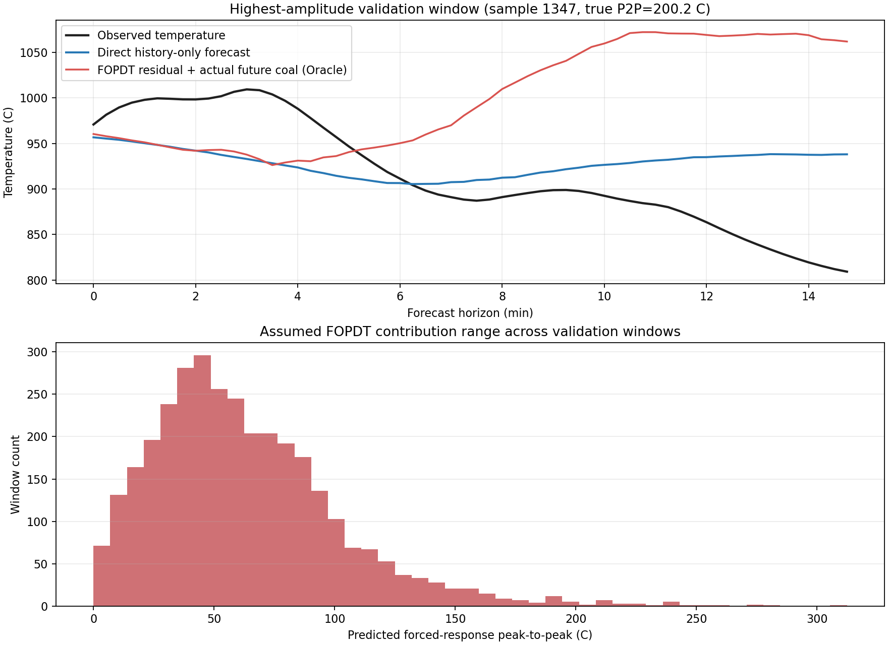

# 控制导向预测原型：实现与 sa-208 首轮训练

**状态：原型训练完成；未通过准入，不可用于现场控制。** 本轮只读使用 sa-208 现有 CSV，在 GPU1 训练；未访问 IOT、未写现场、未下发动作。

## 1. 本轮做了什么

围绕讨论里的核心结构，新增了三个最小代码文件：

- [`control_forecast.py`](control_forecast.py)：Patch 编码器＋未来时间 Query/Cross-Attention，输出未来温度增量；另实现固定参数的增量 FOPDT 候选动作响应和控制导向 Loss。
- [`train_control_forecast.py`](train_control_forecast.py)：从原 CSV 构造 15 秒样本，按时间切分训练/验证，并分别训练普通历史预测与 FOPDT 残差两种方案。
- [`test_control_forecast.py`](test_control_forecast.py)：检验保持动作零响应、正负动作响应、死区、残差重组与梯度。

输入在推理时只使用起点前 60 分钟的 `decompose_temp`、`feed_actual` 及**起点已知的候选未来煤量轨迹**；输出未来 15 分钟温度轨迹。训练残差臂时，未来真实煤量仅用于离线标签修正和事后 Oracle 评价，不允许作为在线输入。

## 2. 数据与计算约定

数据源为 `/opt/wwl_temp/fjl_temp_rl/fjl_5s_all.csv`。脚本检查原始时间戳严格 5 秒递增，再每三点取一点形成 15 秒序列。按 `decompose_temp > 800℃ AND sat_temp > 800℃` 筛开窑，仅保留历史窗和未来窗都连续有效的起点。历史窗 240 点（60 分钟），预测窗 60 点（15 分钟），窗口起点步长 16 点（4 分钟）。

时间折：训练目标终点早于 `2026-10-01`；验证起点不早于 `2026-10-01 01:00`、目标终点早于 `2026-10-15`。训练窗口 **95,826** 个，验证集共 **3,302** 个。这是既有历史数据上的开发验证，不是新盲测；没有运行测试集推理。

Patch 长度 8 点、步长 4 点（59个 Patch），`d_model=64`、2层 Transformer。FOPDT 固定使用讨论中的经验先验：`K=15℃/(t/h)`、`tau=200s`、纯滞后 1 个 15 秒步长；其响应全过程和参数均未经本轮独立动作实验辨识。

Loss 使用远期二次增权（归一化后约 0.5→2.0）、880/950℃阈值附近额外 Huber 权重、斜率拟合项和小权重二阶平滑项。**没有启用强制振幅匹配**，避免在安静窗口虚构波动；振幅作为评估指标报告。

## 3. 本次原型的边界

这是按讨论先做的**可训练最小原型**，不等于 Gemini 文档中的完整终版：当前 Patch 对温度/煤量联合投影，尚未实现温度/尾煤双流独立编码；也未加入希尔伯特相位、显式热累积特征、变参数 `K/τ` 或 O₂ 调制。没有可核验 O₂ 契约，且固定 FOPDT 在闭环数据下缺乏独立动作辨识，因此不贸然把这些复杂项实现成事实。当前原型用于检验核心假设，不输出控制动作、不包含现场接口。

## 4. sa-208 训练结果

运行设备为 RTX 2080 Ti GPU1。对照臂使用相同的模型结构、时间折和验证起点：

| 方案 | 最佳轮次 | 验证加权轨迹 RMSE | 15分钟端点 RMSE | 全点绝对误差 P90 | 最大时距均值偏差 | 平均预测/真实峰峰值 |
|---|---:|---:|---:|---:|---:|---:|
| 直接历史预测 | 11 | **24.21℃** | **26.82℃** | 38.48℃ | 7.42℃ | 33.92 / 56.73℃ |
| 固定FOPDT残差 + 真实未来煤量 Oracle | 10 | **48.69℃** | **56.08℃** | 72.76℃ | 8.41℃ | 60.54 / 56.73℃ |

直接预测振幅仍明显收缩（平均预测峰峰值约为真实的 60%），整体误差远高于讨论中的控制准入值（加权轨迹≤8℃、端点≤10℃、最大时距偏差≤2℃、P90≤15℃）。故基线不准入。

残差方案的验证重构使用真实未来尾煤，属于 **Oracle 事后条件回放**，不是在线候选动作精度；它仍比直接历史预测差很多。把未来煤量保持当前值时与历史实测温度比较的指标，因真实历史未来煤量并非保持不变，不是公平的“无动作反事实”，只作为方案诊断保存。

## 5. 关键诊断与结论

用该固定 FOPDT 先验算出的未来尾煤贡献，在验证窗口中的范围约为 **−284℃ 至 +312℃**，平均绝对贡献约 **27.3℃**，平均峰峰值约 **62.8℃**；不少窗口的模型动作响应幅度已经大于温度本身的实际变化。FOPDT 响应与温度变化的样本点相关约 −0.70，只说明闭环中存在反向相关，**不表示尾煤因果作用为负**。该结果说明固定先验在当前数据/单位/工况上的分解很可能不匹配，不能直接把温度标签按此模型剥离，更不能据此生成给煤动作。

高振幅验证个例中，直接模型明显缩幅；残差＋未来真实尾煤 Oracle 轨迹反而严重过冲。图中 Oracle 曲线只用于展示误差来源，不能解释为可部署性能：



**本轮决策：** 保留直接预测作为基线；残差/FOPDT分支不晋升为候选控制模型。状态依赖 `K/τ`、O₂调制、候选给煤仿真均未获验证。下一步应先审计尾煤单位/范围与数据动作契约，对 `K、τ、dead_steps` 做离线敏感性诊断；只有独立动作证据可用后，才考虑估计变参数或评估候选动作反事实。

## 6. 复现与产物

本地单测：

```bash
PYTHONPATH=model_1116 python3 -m unittest model_1116.test_control_forecast
```

结果：5 项通过。训练脚本和产物已同步保存在：

- 代码：`model_1116/control_forecast.py`、`model_1116/train_control_forecast.py`、`model_1116/test_control_forecast.py`
- sa-208实验归档：`model_1116/sa208_control_forecast_v1/`
- 远程原始训练位置：`sa@100.80.232.116:/opt/wwl_temp/seq2seq_fjl_temp_20261111/cycle_c_job/model_1116/control_forecast_v1/`

归档包含 `best.pt`、`history.csv`、`protocol.json`、验证指标、逐窗口预测与日志。协议中的原始行数元数据已从派生计数更正为 CSV 实际行数 6,289,921；该修正不改变训练样本或模型结果。
